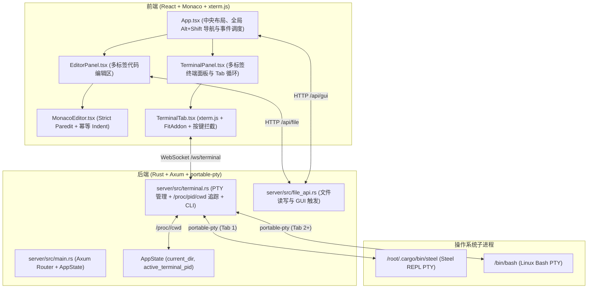
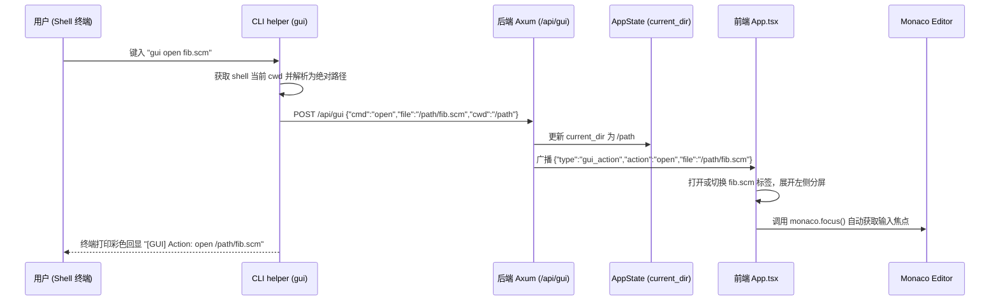

# 终端黑客 IDE 架构与通信协议设计手册 (Terminal Hacker IDE Architecture)

## 1. 架构总览与核心设计哲学

Scheme Strict Paredit IDE 采用**以终端为中心（Terminal-Centric）的极简黑客生产力架构**：

1. **极简主义（Zero Bloat）**：彻底去除传统 Web IDE 繁重的顶部菜单栏、状态栏和左侧文件树面板。整个界面由纯净的多标签代码编辑区与多标签 PTY 终端区构成。
2. **冷启动全宽终端（Cold Start 100%）**：启动初期仅显示 100% 宽度的终端。用户首先置身于纯粹的终端交互环境中。
3. **按需展开与自动折叠（Dynamic Split & Collapse）**：
   - 当用户在终端中键入 `gui open <file>` 或在编辑区新建文件时，左侧编辑面板动态平滑展开，默认按 **60 : 40**（编辑器 60%，终端 40%）呈现。
   - 打开文件后，编辑器**自动夺取输入焦点（Auto-Focus）**，光标立刻在左侧第一行闪烁，手无需离开键盘即可继续编码。
   - 用户可通过中间 4px 分割条自由拖拽左右比例，或通过 `gui ratio <L:R>` 精确调整。
   - 当左侧所有代码标签页关闭后，编辑面板自动折叠回 0% 宽度，终端重新占据 100% 全屏。
4. **真实 PTY 统一终端（Native PTY Terminal）**：
   - **Tab 1（λ REPL）**：常驻运行原生 **Steel Scheme 0.8.2**（真实 PTY 进程）。
   - **Tab 2+（Bash）**：独立的 Linux `/bin/bash` 真实 PTY 实例，支持自由新建与销毁。
   - 彻底摒弃伪终端与字符串仿真，支持完全的原生 ANSI 颜色、终端光标移动、Tab 补全与信号控制。
5. **原生二进制与 PATH 自动注入（Native Single-Binary CLI）**：
   - `scheme-ide` 编译为单一静态/单文件可执行文件，内嵌了完整的前端静态资源、Steel REPL 以及 CLI 子命令分发。
   - 在 PTY 启动时，自动将 `gui` 包装可执行脚本所在目录注入到当前 Shell 的 `PATH` 环境变量最前端。
   - 用户在终端直接输入 `gui open`、`gui cd` 等命令享受原生 Tab 路径补全，零外部依赖，绝不产生 `bash: command not found`。
6. **内核级工作目录实时记忆（CWD State Persistence）**：
   - 利用 Linux 底层 `/proc/<pid>/cwd` 内核符号链接，后端实时追踪活跃终端的真实当前工作目录。
   - 新建终端 Tab 时**自动继承当前活跃 Tab 的最新目录**（不再被重置回根目录）。
   - 后端 `/api/file` 的相对路径解析全面与活跃 `current_dir` 挂钩。
7. **全键盘无缝漫游（Tmux/i3 级焦点与 Tab 导航）**：
   - `Alt + Shift + Up`：焦点瞬间切回代码编辑器。
   - `Alt + Shift + Down`：焦点瞬间切回 Shell 终端（拦截 Xterm 乱码）。
   - `Alt + Shift + Left / Right`：在当前聚焦区内循环轮转 Tab（首尾自动回环 Wrap-around）。

---

## 2. 系统架构时序与组件关系



---

## 3. 通信协议与数据流

### 3.1 WebSocket 终端通信 (`/ws/terminal`)

* **URL 规范**：`ws://host:port/ws/terminal?tab_id=<string>&cmd=<steel|bash>`
  - `tab_id`：前端分配的唯一终端标签标识符（例如 `repl`, `bash-1`）。
  - `cmd`：启动的底层命令类型（`steel` 或 `bash`）。

* **客户端 $\rightarrow$ 服务端消息**：
  1. **原始按键流（Raw Bytes）**：用户键入的 ASCII / UTF-8 字符流（如按键、回车、退格、Ctrl+C 等），直接送入子进程 PTY `Write`。
  2. **终端窗口尺寸重置（JSON 格式）**：
     ```json
     {
       "type": "resize",
       "cols": 120,
       "rows": 36
     }
     ```
     后端调用 PTY 的 `resize(PtySize)` 动态对齐行列数。

* **服务端 $\rightarrow$ 客户端消息**：
  1. **PTY 原始输出（Binary / Text）**：子进程标准输出与标准错误合并流（包含 ANSI 颜色码与控制序列），直接送入 xterm.js 的 `terminal.write(...)`。
  2. **GUI 动作广播（JSON 格式）**：
     ```json
     {
       "type": "gui_action",
       "action": "open",
       "file": "/workspace/scheme_edit/src/factorial.scm"
     }
     ```

---

## 4. 终端 CLI `gui` 与工作目录追踪机制

用户在终端中键入 `gui open <file>`、`gui cd <dir>` 等命令时，通过底层 HTTP 与 PTY 内核交互无缝驱动 IDE：



### 4.1 CLI 命令语法规范

| 命令 | 语法示例 | 行为说明 |
| :--- | :--- | :--- |
| **打开 / 编辑文件** | `gui open [file]` 或 `gui edit [file]` | 打开或切换指定文件，展开编辑区并**自动聚焦光标**；未指定时默认打开 `scratch-*.scm` |
| **关闭文件** | `gui close [file]` | 关闭指定或当前活跃文件；全部关闭时自动折叠左侧面板 |
| **切换工作目录** | `gui cd [dir]` | 显式更新 IDE 后端记忆的工作目录，相对路径以其为基准 |
| **调整分屏比例** | `gui ratio <L:R>` | 动态更新左右分屏比例（例如 `gui ratio 60:40`、`gui ratio 0:100` 折叠） |
| **帮助菜单** | `gui help` | 打印终端色彩帮助信息 |

---

## 5. 全局导航快捷键系统 (Global Focus & Tab Navigation)

为了实现类似 tmux / i3 的全键盘流转体验，IDE 注册了专属全局高优先级导航快捷键：

| 快捷键 | 作用域 | 核心功能与交互 |
| :--- | :--- | :--- |
| **`Alt + Shift + Up`** (Mac: `⌥ ⇧ ↑`) | 全局 | **输入焦点跳转到代码编辑器**（若当前未打开文件，自动创建 scratch 便签并聚焦） |
| **`Alt + Shift + Down`** (Mac: `⌥ ⇧ ↓`) | 全局 | **输入焦点跳转到 Shell 窗口**（拦截 Xterm 转义字符，杜绝终端乱码） |
| **`Alt + Shift + Left`** (Mac: `⌥ ⇧ ←`) | 当前聚焦区 | **循环切换到上一个 Tab**：在代码区切文件 Tab；在终端区切 Shell Tab；**首尾自动回环 (Wrap-around)** |
| **`Alt + Shift + Right`** (Mac: `⌥ ⇧ →`) | 当前聚焦区 | **循环切换到下一个 Tab**：在代码区切文件 Tab；在终端区切 Shell Tab；**首尾自动回环 (Wrap-around)** |

---

## 6. Monaco 代码发射与 REPL 自动聚焦联动

当在左侧编辑区编写 Scheme 代码时：
1. 用户在 Monaco 编辑器中按下 **`Alt + Enter`** 或 **`Ctrl + Enter`**（Mac: `⌥ ↵` 或 `⌘ ↵`）。
2. `App.tsx` 提取当前光标所处的 S-expression。
3. **终端面板平滑切页**：
   - 终端面板自动将当前活跃标签切换为 Tab 1（`λ REPL`）。
4. **代码流式写入**：
   - 通过 Tab 1 的专属 WebSocket 发送提取的 Scheme 代码与换行符 `\n`。
5. **滚动对齐**：
   - Tab 1 终端调用 `terminal.scrollToBottom()`，保证光标和求值结果即时可见。

---

## 7. 文件系统 API 规范

* **`GET /api/file?path=<relative_or_absolute_path>`**
  - 读取指定路径文件内容（相对路径动态以 `AppState.current_dir` 为基准解析）。
  - 成功返回：`{"ok": true, "path": "...", "content": "..."}`
  - 失败返回：`{"ok": false, "error": "..."}`

* **`POST /api/file`**
  - 保存文件内容（自动创建不存在的父目录）。
  - 请求体：`{"path": "...", "content": "..."}`
  - 成功返回：`{"ok": true, "path": "..."}`

* **`POST /api/file`**
  - 保存编辑内容到文件。
  - 请求体：`{"path": "...", "content": "..."}`
  - 成功返回：`{"ok": true, "path": "..."}`

* **`POST /api/gui`**
  - HTTP 方式触发 GUI 动作（支持外部脚本或 VS Code 插件调用）。
  - 请求体：`{"action": "open", "file": "..."}`
  - 成功返回：`{"ok": true, "action": {...}, "broadcasted": true}`
