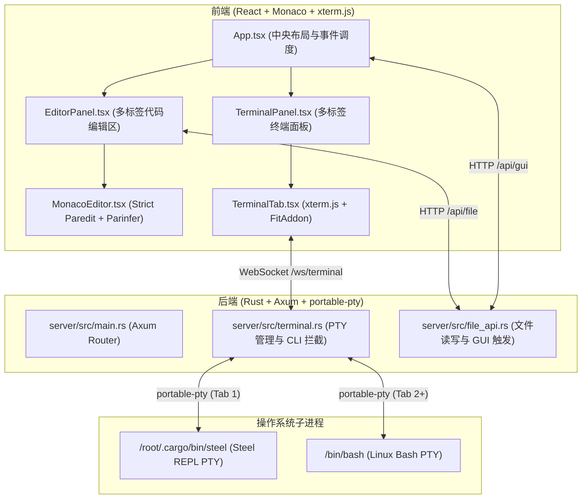
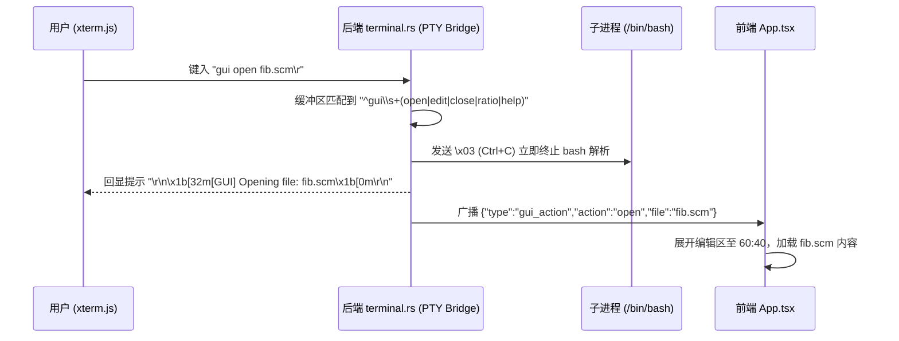

# 终端黑客 IDE 架构与通信协议设计手册 (Terminal Hacker IDE Architecture)

## 1. 架构总览与核心设计哲学

Scheme Strict Paredit IDE 采用**以终端为中心（Terminal-Centric）的极简黑客生产力架构**：

1. **极简主义（Zero Bloat）**：彻底去除传统 Web IDE 繁重的顶部菜单栏、状态栏和左侧文件树面板。整个界面由纯净的多标签代码编辑区与多标签 PTY 终端区构成。
2. **冷启动全宽终端（Cold Start 100%）**：启动初期仅显示 100% 宽度的终端。用户首先置身于纯粹的终端交互环境中。
3. **按需展开与自动折叠（Dynamic Split & Collapse）**：
   - 当用户在终端中键入 `gui open <file>` 或在编辑区新建文件时，左侧编辑面板动态平滑展开，默认按 **60 : 40**（编辑器 60%，终端 40%）呈现。
   - 用户可通过中间 4px 分割条自由拖拽左右比例，或通过 `gui ratio <L:R>` 精确调整。
   - 当左侧所有代码标签页关闭后，编辑面板自动折叠回 0% 宽度，终端重新占据 100% 全屏。
4. **真实 PTY 统一终端（Native PTY Terminal）**：
   - **Tab 1（λ REPL）**：常驻运行原生 **Steel Scheme 0.8.2**（真实 PTY 进程）。
   - **Tab 2+（Bash）**：独立的 Linux `/bin/bash` 真实 PTY 实例，支持自由新建与销毁。
   - 彻底摒弃伪终端与字符串仿真，支持完全的原生 ANSI 颜色、终端光标移动、Tab 补全与信号控制。
5. **零依赖 CLI 拦截（Zero-Dependency CLI Interception）**：
   - 终端中的 `gui` 命令直接在 Rust 后端 PTY 字节流层拦截并处理。
   - 不需要为操作系统安装任何外部软件包或在 PATH 中放置 shell 脚本，绝不产生 `bash: command not found`。

---

## 2. 系统架构时序与组件关系



---

## 3. 通信协议与数据流

### 3.1 WebSocket 终端通信 (`/ws/terminal`)

* **URL 规范**：`ws://host:port/ws/terminal?tab_id=<string>&cmd=<steel|bash>`
  - `tab_id`：前端分配的唯一终端标签标识符（例如 `tab-repl`, `tab-bash-12345`）。
  - `cmd`：启动的底层命令类型（`steel` 或 `bash`）。

* **客户端 $\rightarrow$ 服务端消息**：
  1. **原始按键流（Raw Bytes）**：用户键入的 ASCII / UTF-8 字符流（如按键、回车、退格、Ctrl+C 等），直接送入子进程 PTY `Write`。
  2. **终端窗口尺寸重置（JSON 格式）**：
     ```json
     {
       "type": "resize",
       "cols": 120,
       "rows": 36
     }
     ```
     后端调用 PTY 的 `resize(PtySize)` 动态对齐行列数。

* **服务端 $\rightarrow$ 客户端消息**：
  1. **PTY 原始输出（Binary / Text）**：子进程标准输出与标准错误合并流（包含 ANSI 颜色码与控制序列），直接送入 xterm.js 的 `terminal.write(...)`。
  2. **GUI 动作广播（JSON 格式）**：
     ```json
     {
       "type": "gui_action",
       "action": "open",
       "file": "src/factorial.scm"
     }
     ```

---

## 4. 终端 CLI `gui` 命令拦截核心机制

为了让用户在任意 Bash 终端中敲击 `gui open <file>` 能直接驱动浏览器打开文件标签，同时**不依赖宿主环境安装额外软件**，后端实现了字节流拦截器：



### 4.1 拦截命令语法规范

1. **打开 / 编辑文件**：
   - 语法：`gui open <filepath>` 或 `gui edit <filepath>`
   - 行为：拉取文件内容并在编辑区新建 Tab；若已打开则平滑切换聚焦；展开比例默认 60:40。
2. **关闭文件**：
   - 语法：`gui close [filepath]`
   - 行为：若指定文件名则关闭对应 Tab；若未指定则关闭当前活跃 Tab；若全部关闭则自动折叠编辑区。
3. **调整分屏比例**：
   - 语法：`gui ratio <L:R>`（例如 `gui ratio 70:30`, `gui ratio 50:50`, `gui ratio 0:100`）
   - 行为：动态更新前端分割比例；`0:100` 时等价于完全隐藏左侧编辑区。
4. **帮助信息**：
   - 语法：`gui help`
   - 行为：终端就地打印格式化彩色帮助菜单。

---

## 5. Monaco 代码发射与 REPL 自动聚焦联动

当在左侧编辑区编写 Scheme 代码时：
1. 用户在 Monaco 编辑器中按下 **`Alt + Enter`** 或 **`Ctrl + Enter`**（Mac: `⌥ ↵` 或 `⌘ ↵`）。
2. `App.tsx` 提取当前光标所处的 S-expression。
3. **终端面板平滑切页**：
   - 终端面板自动将当前活跃标签切换为 Tab 1（`λ REPL`）。
4. **代码流式写入**：
   - 通过 Tab 1 的专属 WebSocket 发送提取的 Scheme 代码与换行符 `\r`。
5. **滚动对齐**：
   - Tab 1 终端调用 `terminal.scrollToBottom()`，保证光标和求值结果即时可见。

---

## 6. 文件系统 API 规范

* **`GET /api/file?path=<relative_or_absolute_path>`**
  - 读取指定路径文件内容。
  - 成功返回：`{"ok": true, "path": "...", "content": "..."}`
  - 失败返回：`{"ok": false, "error": "..."}`

* **`POST /api/file`**
  - 保存编辑内容到文件。
  - 请求体：`{"path": "...", "content": "..."}`
  - 成功返回：`{"ok": true, "path": "..."}`

* **`POST /api/gui`**
  - HTTP 方式触发 GUI 动作（支持外部脚本或 VS Code 插件调用）。
  - 请求体：`{"action": "open", "file": "..."}`
  - 成功返回：`{"ok": true, "action": {...}, "broadcasted": true}`
